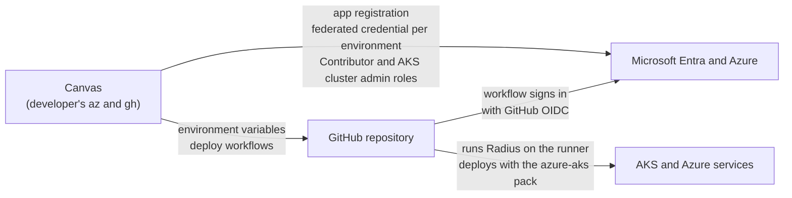
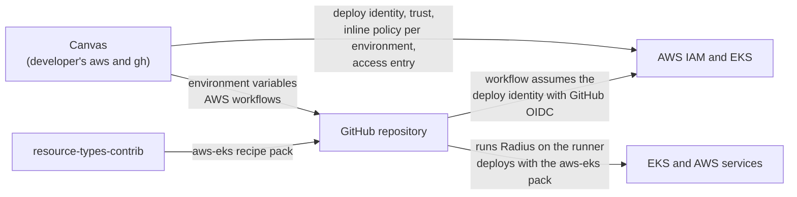
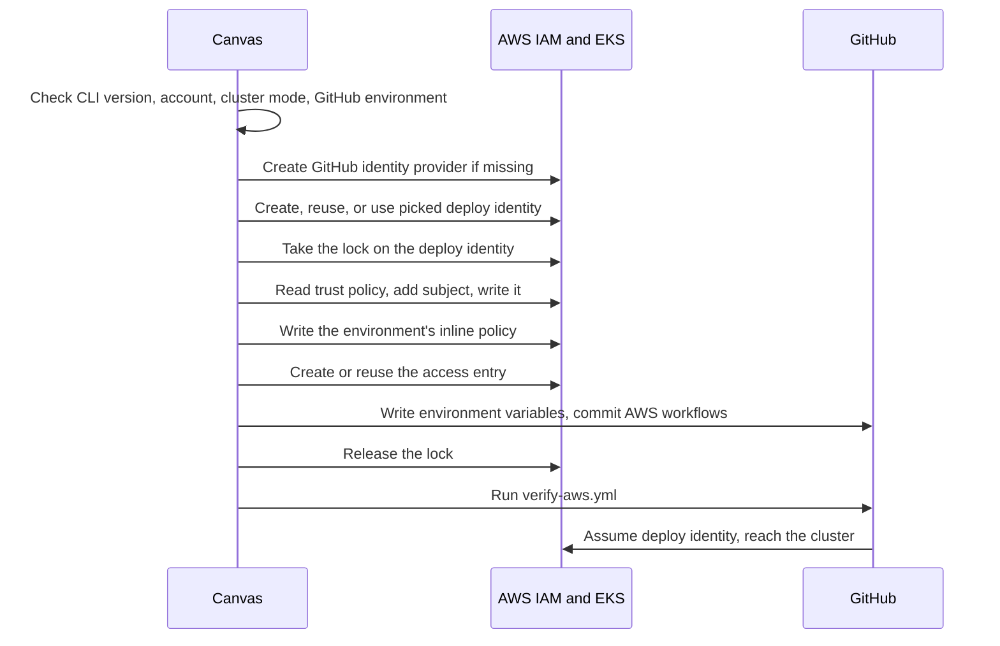

# AWS and EKS support in the Radius canvas

- **Author**: Karishma Chawla (@kachawla)
- **Date**: 2026-10

## Summary

The Radius canvas deploys apps only to Azure today. A developer whose team runs on AWS and Amazon EKS can't connect an account, create an environment, or deploy from the canvas. The provider list shows "AWS (coming soon)".

This design adds AWS as a second provider with the same journey and screens as Azure: connect an account, create an environment on an existing EKS cluster, deploy, see the deployed graph, and delete. Most of it maps one to one from Azure. The hard part is the IAM role GitHub Actions uses to deploy, called the deploy identity: AWS has no per-environment object like Azure's federated credential, so environments share one role, its size limits, and its trust policy. This design settles that, and the spec's open engineering questions, with these decisions:

- **One deploy identity per repository per AWS account,** shared by its environments, the same as one app registration on Azure.
- **One inline policy per environment,** with `PowerUserAccess` limited to the environment's region. A deploy identity holds about 17 environments, close to Azure's 20.
- **A lock on the deploy identity,** shared by every repository that uses it, held while setup, delete, rollback, or **Repair** changes it.
- **Bicep recipes in a `resource-types-contrib` pack,** with EKS Pod Identity for apps that need AWS credentials.
- **Tokens refreshed every 2 minutes** during deploys.

A working prototype deployed a real app to EKS with MySQL on Amazon RDS, and this doc is based on it. AWS stays hidden from users until all of it ships.

## Background

### How an Azure environment works today

The canvas runs on the developer's machine and uses their `az` and `gh` sessions. Creating an environment makes everything a GitHub workflow needs to deploy without a stored secret:



- **One app registration per repository.** The canvas creates `radius-deploy-<owner>-<repo>`, or the developer picks an existing one.
- **One federated credential per environment.** It trusts GitHub's token for that one GitHub environment. An app registration holds at most 20.
- **Role assignments per environment.** Contributor on the environment's resource group, and AKS RBAC Cluster Admin on its cluster.
- **A GitHub environment** holds the IDs the workflow needs, and the canvas commits the deploy workflows to the repository.

A deploy runs `run-rad-commands.yml` in GitHub Actions. It signs in to Azure with GitHub's OIDC token, starts the Radius control plane on the runner, and deploys the app with the `azure-aks` recipe pack from `resource-types-contrib`. Because GitHub's token lasts 5 minutes, a background script refreshes it every 2 minutes during the deploy.

### What changes on AWS

| What it's for                                        | Azure                                     | AWS                                                                           |
|------------------------------------------------------|-------------------------------------------|-------------------------------------------------------------------------------|
| Where the environment lives                          | Subscription                              | Account and region                                                            |
| The identity GitHub Actions signs in as to deploy    | App registration                          | IAM role, the deploy identity                                                 |
| Lets one GitHub environment sign in as that identity | Federated credential, one per environment | A subject in the role's trust policy. All environments share one trust policy |
| What the deploy is allowed to change                 | Role assignment, one per environment      | An inline policy on the role. All environments share the role's size limit    |
| Admin access to the cluster's Kubernetes API         | AKS RBAC Cluster Admin                    | An EKS access entry with `AmazonEKSClusterAdminPolicy`                        |
| What the canvas discovers to deploy into             | Resource group and AKS cluster            | EKS cluster, VPC, and subnets                                                 |
| Maps each Radius type to the recipe that creates it  | `azure-aks` recipe pack                   | `aws-eks` recipe pack                                                         |

The last three rows are close matches. The first rows are where AWS differs: the per-environment objects Azure creates become edits to one shared role.

### Terms

- **Subject**: the text in GitHub's OIDC token that names the repository and environment, such as `repo:contoso/storefront:environment:dev`.
- **GitHub identity provider**: the account-level IAM object that lets AWS accept GitHub's OIDC tokens. One serves every repository in the account.
- **Recipe pack**: the list that maps each Radius resource type to the recipe that creates it.

## Problem

This example is used through the rest of the doc. The repository `contoso/storefront` has an app with a container and a MySQL database. The team wants two environments in AWS account `111122223333`: `dev` in `us-west-2` on the EKS cluster `storefront-dev`, and `prod` in `us-east-1` on `storefront-prod`.

Both environments use one deploy identity, `radius-deploy-contoso-storefront`, the same way both Azure environments would use one app registration. Its trust policy lists both subjects:

```json
{
  "Effect": "Allow",
  "Principal": { "Federated": "arn:aws:iam::111122223333:oidc-provider/token.actions.githubusercontent.com" },
  "Action": "sts:AssumeRoleWithWebIdentity",
  "Condition": {
    "StringEquals": {
      "token.actions.githubusercontent.com:aud": "sts.amazonaws.com",
      "token.actions.githubusercontent.com:sub": [
        "repo:contoso/storefront:environment:dev",
        "repo:contoso/storefront:environment:prod"
      ]
    }
  }
}
```

Sharing one role causes problems that Azure's separate objects avoid:

**Two setups can overwrite each other.** Setup reads the trust policy, adds its subject, and writes the policy back. If `dev` and `prod` are set up at the same moment, both read the policy before either writes, and the later write drops the other's subject. IAM has no conditional write to prevent this. The lost environment's deploys then fail to sign in.

**Permissions must be scoped per environment.** `dev` should deploy only to `us-west-2`, and `prod` only to `us-east-1`. Attaching AWS's `PowerUserAccess` policy would allow every region. Adding a deny for other regions per environment doesn't work either, because denies add up: `dev`'s deny of `us-east-1` would also block `prod`.

**Deletes must remove only one environment's changes.** Deleting `dev` must leave `prod` working. If a platform team gave the developer an existing role that other repositories also use, deleting must not touch what those repositories need.

**IAM size limits are shared.** A role's inline policies share 10,240 characters, and the trust policy allows 2,048 characters by default. Every environment uses some of both.

**Deploys outlive their tokens.** Creating the RDS database takes about 15 to 20 minutes. GitHub's token lasts 5 minutes and an EKS token lasts 15, so the deploy fails at the next step unless both are refreshed.

**Some apps can't get AWS credentials.** On Azure, a storage recipe returns a key the app uses. Amazon S3 and Amazon Bedrock accept only IAM credentials, which a recipe can't hand back as a key.

## Goals and non-goals

### Goals

1. A developer can connect an AWS account, create an environment on an existing EKS cluster, deploy, see the deployed graph, and delete, through the same screens as Azure.
2. A developer can use an IAM role their platform team owns, and Radius never deletes it.
3. A second environment in the same account reuses the repository's deploy identity and leaves the first one working, even when both are set up at once.
4. A deploy runs the app's backing services as AWS managed services.
5. A deploy that runs longer than the GitHub and EKS token lifetimes still succeeds.
6. Deleting an environment removes only what that environment added in AWS.
7. Setup that stops part way can be rolled back or retried.

### Non-goals

1. **App credentials for S3 and Bedrock.** This doc records the choice of EKS Pod Identity. The work, and the recipes for those two types, are designed and built separately.
2. **Kafka on AWS in the first release.** Radius can't yet read Amazon MSK's broker addresses, and no Kubernetes Kafka recipe exists for any cloud.
3. **AWS resource coverage in Radius Bicep.** That's the full AWS coverage design.
4. **Creating or changing EKS clusters, VPCs, or subnets.** The canvas only discovers them, the same as for AKS.
5. **Deploying to a VPC other than the cluster's.** Each recipe puts its service in the cluster's security group, which belongs to the cluster's VPC.
6. **Clusters whose API is reachable only from a private network.** GitHub's runners can't reach them. They're handled the same as on Azure, and a check for both clouds is separate work.

## Design overview

Each AWS environment adds four things to AWS, all on the repository's one deploy identity or next to it:

| What                                                                       | Shared by                                          | Removed when the environment is deleted                                          |
|----------------------------------------------------------------------------|----------------------------------------------------|----------------------------------------------------------------------------------|
| The environment's subject in the deploy identity's trust policy            | All environments in the repository                 | Yes                                                                              |
| An inline policy with the environment's permissions, limited to its region | Nothing, one per environment                       | Yes                                                                              |
| An access entry on the environment's EKS cluster                           | Environments in the repository on the same cluster | When no other environment uses it, and only for a deploy identity Radius created |
| The GitHub identity provider and the deploy identity                       | The whole account, and the whole repository        | Never                                                                            |



In the example, `prod`'s setup finds the role `dev` created, adds its own subject and a policy limited to `us-east-1`, and adds an access entry on `storefront-prod`. Deleting `dev` later removes only `dev`'s three, and `prod` keeps working. A deploy runs MySQL as an Amazon RDS instance and the container on the cluster.

## Detailed design

### Connecting an AWS account

A credential profile holds an AWS account ID and a region, and no role. **Verify Credentials** runs `aws sts get-caller-identity` on the developer's machine:

- **Signed in to the profile's account:** verified, and Save is enabled.
- **Signed in to a different account:** verification fails and Save stays blocked, naming both accounts.
- **No session:** the canvas shows **Sign in to AWS CLI**, which runs `aws sso login`.
- **CLI missing, or older than 2.15.3:** stops, naming the installed and required versions and linking to the installer. Access entries need 2.15.3 or later.

The canvas uses the AWS CLI's default credentials, and checks that their account matches the profile. The profile stores no secrets. Deleting a profile never changes anything in AWS, and environments keep working, because each environment keeps its own copy of the values.

### The deploy identity

**One per repository per AWS account.** A second environment in the same account adds itself to the existing deploy identity instead of creating another. An IAM role can't be used from another account, so environments in different accounts get one deploy identity each.

**Name.** The default name is `radius-deploy-<owner>-<repo>`. IAM role names allow at most 64 characters. A longer name keeps its first 57 characters, then adds `-` and the first 6 characters of a SHA-256 hash of `owner/repo`. The hash keeps two long repository names from being shortened to the same role name. The developer can type another name.

**How Radius knows a role is its own.** Radius tags a role it creates with `radius-managed=true` and `radius-repository=<owner>/<repo>`.

- **No role has the proposed name:** setup creates it with both tags.
- **A role tagged for this repository has it:** setup reuses it.
- **A role without the tags has it:** setup stops and changes nothing, because the role belongs to someone else. The developer can pick it on purpose instead.

**Picking an existing role.** "use an existing role…" opens a picker, like Azure's application picker. It lists the IAM roles the signed-in identity can read, except AWS service-linked roles, which GitHub can't assume. Each row shows the role name and the repositories its trust policy already accepts. Roles that already trust GitHub are listed first. The picker refuses two kinds of roles:

- A role in another account, because it can't be used from this one.
- A role Radius tagged for another repository, because that repository's environment delete could remove cluster access this one still uses.

Radius never tags or deletes a picked role, and only adds and removes what each environment needs.

### Which GitHub environments can use the deploy identity

The trust policy has one statement for the account's GitHub identity provider, listing every accepted subject, as in the example under [Problem](#problem). Setup adds the environment's subject to that list, and leaves any statement that doesn't name the GitHub identity provider unchanged. Setup builds the subject with the same code Azure uses, so it matches what GitHub sends.

**Two setups at once.** Setup, delete, rollback, and **Repair** each take a lock on the deploy identity before they read its trust policy. Setup holds it until **Configure environment** has written the GitHub environment, so a delete or rollback that checks which environments use a cluster always sees an environment that's being set up. The lock is an IAM policy named `radius-lock-<role>`: AWS refuses to create a policy whose name already exists, so only one holder can create it, and deleting it releases the lock. It lives in AWS, so every repository that uses the role shares it, even when the role was picked. A second setup waits for the lock. A lock older than 10 minutes is treated as abandoned, so a crashed setup doesn't block the role forever.

Someone can still change the trust policy by hand, outside Radius. The verify workflow fails when GitHub can't assume the deploy identity, and a deploy that fails for the same reason offers **Repair**, which adds the subject back.

If the trust policy can't be read, setup stops without writing, so it never replaces a policy it couldn't see.

### What the deploy identity can change in AWS

Each environment adds an inline policy named `radius-<environment>-<hash>`. The hash is the first 8 characters of a SHA-256 hash of `owner/repo:environment`, so two repositories that share a picked role, each with a `dev` environment, don't overwrite each other's policy. A long environment name is shortened to fit IAM's 128-character limit for policy names, and the hash keeps it unique.

The policy has the statements of AWS's `PowerUserAccess`, with every action limited to the environment's region by the `aws:RequestedRegion` condition. A few global read actions, such as listing regions, stay unlimited. A deploy identity Radius created can therefore act in exactly the regions its environments use, and deleting an environment removes that region again. A picked role keeps whatever permissions it already had: Radius adds and removes only its own policy, and the platform team that owns the role decides the rest.

**Why not narrower.** Within its region, the deploy identity can create any AWS service, the same breadth Azure gives it with Contributor on the environment's resource group. Like Contributor, it can also use roles that already exist in the account through services that run code, for example by updating a Lambda function whose role has more access. Teams that need to rule that out use a separate AWS account for each environment. The narrower options don't work:

- **Limiting by tag:** many AWS create calls can't be limited by a tag condition, and every recipe would have to tag everything it creates.
- **A permissions boundary:** it caps what the role can do, but doesn't narrow it below `PowerUserAccess` on its own.
- **A policy that lists only the pack's services:** it would break the repository's own custom recipes, which can use any AWS type.

Two kinds of actions aren't granted:

| Actions                                                                                                                                                           | How                                                                                                                                                                                                                                                                                                                                | Why                                                                                                              |
|-------------------------------------------------------------------------------------------------------------------------------------------------------------------|------------------------------------------------------------------------------------------------------------------------------------------------------------------------------------------------------------------------------------------------------------------------------------------------------------------------------------|------------------------------------------------------------------------------------------------------------------|
| `iam:*`, `organizations:*`, `account:*`                                                                                                                           | Not granted, except a few global reads and `iam:CreateServiceLinkedRole`. That one is limited to the services the recipe pack uses, such as RDS and OpenSearch, which need it the first time they're used in an account. `iam:DeleteServiceLinkedRole` isn't granted, because a service-linked role is shared by the whole account | The deploy identity can't change IAM directly                                                                    |
| EKS access entry actions (`eks:CreateAccessEntry`, `eks:UpdateAccessEntry`, `eks:DeleteAccessEntry`, `eks:AssociateAccessPolicy`, `eks:DisassociateAccessPolicy`) | Not granted. They're left out of the policy's allowed actions, not denied, because a deny on a picked role would also block other repositories that use that role to manage access entries                                                                                                                                         | Otherwise `PowerUserAccess` would let the deploy identity make itself cluster-admin on any cluster in the region |

**Limits.** Each environment's permissions are an inline policy, so the limit that matters is the inline policies' total size. The limit of 20 attached managed policies per role doesn't apply. The limits are close to Azure's limit of 20 federated credentials per app registration.

- **Inline policies:** a role's inline policies share 10,240 characters, and each environment's policy is about 580, so a deploy identity holds about 17 environments.
- **Trust policy:** it allows 2,048 characters by default, and 8,192 with a quota increase, which is about 30 subjects.

When either limit is reached, setup stops at that step, naming the limit and quoting AWS's error, the same as Azure when an app registration has 20 federated credentials. Each environment keeps its own policy, so adding or deleting one never changes another's permissions. Raising the limit, for example by splitting environments across roles, is a question for both clouds and is separate work.

### Access to the EKS cluster

Setup adds an access entry for the deploy identity on the selected cluster, with AWS's `AmazonEKSClusterAdminPolicy`. That matches Azure, which assigns AKS RBAC Cluster Admin. Setup tags the access entry it creates, so delete can tell it from one someone else made.

Setup grants cluster access while running as the developer, so the deploy workflow never needs the EKS access entry actions above, and no longer creates the access entry on every run. A new access entry is retried for up to a minute, because a new role takes time to spread through IAM.

Access entries need a cluster whose authentication mode is `API` or `API_AND_CONFIG_MAP`.

### Infrastructure discovery

Discovery runs the developer's `aws` CLI with `--region` set to the profile's region.

- **EKS cluster:** from `eks list-clusters`, then `describe-cluster` for each. Clusters in `CONFIG_MAP` mode are listed but can't be selected, and show the `aws eks update-cluster-config` command their owner runs.
- **Namespace:** the cluster's namespaces, or a typed name. A typed name is recorded and created on the first deploy, the same as Azure.
- **VPC:** always the cluster's VPC. Other VPCs aren't offered.
- **Subnets:** from `ec2 describe-subnets` and `describe-route-tables` for the cluster's VPC. Each subnet shows its availability zone, and is labeled public if its route table reaches an internet gateway. Private subnets are checked by default. Picking a public subnet shows a warning.

A selection must span at least two availability zones, because RDS and other VPC-based services require it. A single-zone selection is an error on the Subnets field, and keeps **Create Environment** disabled. If the cluster's private subnets don't span two zones, the form says so and leaves Subnets empty.

### Creating an environment



Setup runs in the same three stages as Azure: **Authorize deploy identity** makes the AWS changes, **Configure environment** writes the GitHub environment variables (`AWS_ROLE_ARN`, `AWS_REGION`, `AWS_ACCOUNT_ID`, `AWS_EKS_CLUSTER_NAME`, `RADIUS_VPC_ID`, `RADIUS_SUBNET_IDS`, and `KUBERNETES_NAMESPACE`) and commits the AWS workflows, and **Verify credentials** runs `verify-aws.yml`. Verify assumes the deploy identity from GitHub, reaches the cluster, and checks it can push to GHCR. Every check that can't change anything runs before the first write to AWS.

The AWS workflows are committed only when the repository creates its first AWS environment. Until then, the deploy dispatcher keeps its AWS job removed, so a repository that only uses Azure never sees AWS files.

**Setup record.** Setup records each AWS change in the setup operation record Azure already uses: role created, subject added, policy written, access entry created. If a step fails after earlier steps wrote to AWS, the **Setup didn't finish** card lists what was created, and **Roll back** takes the lock and undoes those steps in reverse order. It removes an access entry only by the same rule as delete, so it never removes one that another environment reused. Rollback never deletes the GitHub identity provider, or a role Radius didn't create. If the app restarts during setup, the setup is marked interrupted, and **Retry** runs every step again, skipping what already exists.

### Deploying

`run-rad-commands.yml` sends an environment with `AWS_ROLE_ARN` set to `run-rad-commands-aws.yml`. That workflow:

1. Assumes the deploy identity with GitHub's OIDC token.
2. Starts the Radius control plane on the runner, and gives it the GitHub token and a kubeconfig for the EKS cluster.
3. Creates the Radius environment with its AWS account and region, and attaches the `aws-eks` recipe pack.
4. Deploys the app.
5. Publishes the deployed graph and status, including after a failure.

**Tokens.** Every 2 minutes, a background script on the runner gets a new GitHub token and updates the copy the control plane reads. It then uses that token to get a new EKS token and writes it to a token file. The control plane's kubeconfig points at that file with `tokenFile` instead of holding the token itself, because the Kubernetes client library re-reads a token file every minute but never re-reads a token written into the kubeconfig. Radius keeps its Kubernetes clients for the whole deploy, so a new kubeconfig alone wouldn't reach them. After a failed refresh, it retries every 15 seconds while the current token is still valid. Azure refreshes its GitHub token on the same schedule.

**Recipe pack.** The `aws-eks` recipe pack lives in `resource-types-contrib` next to the Azure and Kubernetes packs, and is versioned and published the same way. Its recipes are Bicep. Radius's contrib catalog pins each pack's version, and the deploy workflow reads the pack from there, the same as `azure-aks`. Until the catalog lists `aws-eks`, the canvas reads it from a pinned `resource-types-contrib` commit, which only the developer switch exposes.

The pack's parameters come from the environment: the EKS cluster name, the subnet IDs, and the routes gateway and image registry that the Kubernetes recipes need. The AWS account and region come from the Radius environment.

Each recipe that creates a VPC-based service builds a subnet group from the environment's subnets, and adds the service to the cluster's security group, so pods can reach it without new rules. A security group of its own, open only on the service's port, would be tighter. But AWS generates a security group's ID, so Radius would create a new one on every redeploy. Each service moves to its own security group once the full AWS coverage work lets Radius redeploy resources whose ID AWS generates.

**Redeploys.** Until the idempotent AWS deployments design ships in Radius, an unchanged redeploy of an RDS database isn't fully a no-op: it resends the master password and the subnet list. The database keeps running, and no new resource is created.

**Types the pack doesn't have yet.** The canvas doesn't block a deploy that uses one, such as object storage before pod identity. The planned graph shows that node as unresolved before the deploy. If the developer deploys anyway, that resource fails with Radius's error, the deployed graph marks it failed, and the rest of the app still deploys. A check before deploy would also block types that the repository's own custom recipes supply.

### How apps get AWS credentials

On Azure, a recipe returns a key, such as a storage account key, and the app uses it. Amazon S3 and Amazon Bedrock accept only IAM credentials, which a recipe can't hand back as a key today. We'll use **EKS Pod Identity**: a role per app, with access to only its own resources, linked to the app's pod. The other options are under [Alternatives considered](#other-alternatives).

Pod Identity stores no secret. The app's AWS SDK gets short-lived credentials automatically, so most apps need no code change. It's AWS's recommended way for pods to reach AWS services, and it matches the passwordless model the canvas already uses for deploys. It brings three new requirements:

- **A cluster prerequisite:** the EKS Pod Identity Agent add-on, installed once per cluster. Setup checks for it and tells the developer if it's missing.
- **A change to a shared type:** the container type and its recipe give each app its own Kubernetes service account.
- **More IAM rights for the deploy identity:** it must be able to create per-app roles, limited by a permissions boundary and an IAM path, so it can't create a role with more access than itself.

AWS ships before pod identity, without the object storage and models recipes. The models recipe will create no resource: it returns the regional Bedrock endpoint and a Bedrock model ID, because the type's default model isn't on Bedrock.

### Application graph

The planned graph reads the `aws-eks` recipe pack, and shows each node with its AWS service name, such as "Amazon RDS for MySQL".

The deployed graph shows each resource's status from the deploy, the same as Azure, including the resource's own error when it fails. A deployed AWS resource links to its service's list in the AWS console, in the environment's region, for example the RDS databases list. Kubernetes resources, unknown types, and regions in China get no link, because a link to the wrong page is worse than none. Unlike Azure, whose portal opens any resource from its ID, each AWS service has its own console address, so `aws-console.ts` in core maps each AWS type to its console list. Each new AWS recipe adds its types to that mapping. A type that's missing gets no link, not a wrong one.

### Deleting

**A deployment.** `delete-aws.yml` deletes the app, the same flow as Azure. Radius deletes AWS resources through the AWS Cloud Control API, which removes an RDS database without a final snapshot. The delete confirmation already names each resource it deletes.

**An environment.** `delete-environment-aws.yml` refuses while apps are still deployed, and then deletes the Radius environment. After that, the canvas takes the lock on the deploy identity, removes this environment's subject from the trust policy, and deletes its inline policy. Trust statements Radius didn't add stay as they are. If removing the subject leaves no statements, the canvas writes a single deny statement, because IAM rejects an empty trust policy. The canvas keeps the deploy identity and the GitHub identity provider, the same as Azure keeps the app registration, because other environments or services may use them.

Whether it keeps the access entry depends on who owns the deploy identity:

| Deploy identity         | Access entry on delete                                                                                                                                          | Why                                                                                                                               |
|-------------------------|-----------------------------------------------------------------------------------------------------------------------------------------------------------------|-----------------------------------------------------------------------------------------------------------------------------------|
| Created by Radius       | Removed when no remaining environment in the repository uses that cluster and the trust policy names no other repository. Only an entry setup tagged is removed | The picker refuses this role for other repositories, and the repository's GitHub environments say which clusters are still in use |
| Picked by the developer | Always kept                                                                                                                                                     | Another repository may use the same role on the same cluster, and Radius can't see that repository's environments                 |

The completion message names what was removed and what was kept. Once the last environment is gone, the trust policy accepts no GitHub subject, so no GitHub workflow can assume the deploy identity or use a kept access entry.

### Hidden until it ships

The changes land in small pull requests, with AWS hidden from users until a final change turns it on.

- The provider list keeps "AWS (coming soon)", and **Create Env** stays disabled on AWS profiles.
- The server refuses to create or delete an AWS environment.
- The AWS workflows aren't committed to any repository.
- A developer-only switch, the `RADIUS_CANVAS_AWS=1` environment variable read when the extension starts, lifts all three, so the team can test against real AWS.
- Hidden changes carry no release notes. The final change announces AWS, and moves the deploy to the contrib catalog's `aws-eks` entry.

### Changes by repository

**ai-extensions.**

- `packages/core/src/platforms/aws-identity.ts` and `aws-network.ts`: role and policy names, trust edits, the permission policy, and subnet rules.
- `packages/core/src/domain/aws-console.ts`: console links for the deployed graph.
- `packages/core/src/modeling/recipe-pack.ts`: `AWS_EKS_RECIPE_PACK`, the one place the pinned pack lives, used by the deploy workflow and the planned graph.
- `packages/adapter-canvas/src/server/services/aws-deploy-identity.ts` and `aws-discovery.ts`: setup, delete, and discovery, behind the operation framework Azure setup uses.
- `packages/adapter-canvas/src/aws-switch.ts`: reads the developer switch once in `extension.ts`.
- `.github/extension/`: `run-rad-commands-aws.yml`, `verify-aws.yml`, `delete-aws.yml`, `delete-environment-aws.yml`, and an AWS mode for the token refresher.

**resource-types-contrib.** `recipe-packs/aws-eks` and the AWS Bicep recipes, published by the existing recipe workflows.

**radius.** An `aws-eks` entry in the contrib catalog, `deploy/manifest/defaults.yaml`.

## Failure handling

Two rules run through every case. Every check that can't change anything runs before the first write to AWS. A read that fails never leads to a write, so setup never replaces something it couldn't see.

The checks and their messages are in each section above: the CLI and account checks, cluster modes, role ownership, the picker, the deploy identity lock, **Repair**, token retries, and resources that fail at deploy. The cases below appear only here.

**Stopped before anything changes in AWS.**

- Discovery is denied, or finds nothing: each list says whether the account has none or the signed-in identity can't read them. The namespace still accepts a typed name.
- GitHub environment already set up for Azure: asks for another environment name.
- The lock can't be created because the signed-in identity lacks `iam:CreatePolicy`: names the missing permission.

**Stopped part way.** The **Setup didn't finish** card lists what was created, and offers **Roll back** and **Retry**.

- GitHub identity provider can't be created: shows the `aws iam create-open-id-connect-provider` command for an IAM administrator.
- Role creation denied: suggests picking an existing role or asking for `iam:CreateRole`.
- Picked role can't be changed by the signed-in identity: names the change that was denied, and leaves the role as it was.
- GitHub write fails after the AWS steps succeeded: reported as a failure of the **Configure environment** stage. Retry continues from there.

**Found after setup.**

- Verify credentials fails: says whether GitHub couldn't assume the deploy identity, couldn't reach the cluster, or couldn't push to GHCR, and links to the run. A cluster reachable only from a private network fails here, the same as on Azure.

**At delete.**

- The trust policy can't be read: the canvas stops without writing, and tells the developer to remove the subject by hand.
- Removing the subject or the policy fails: the canvas says which one is left, and **Retry** removes what's still there.
- The deploy identity is already gone: reported as already gone, and the delete continues.

## Security

- **No stored secrets.** Deploys use GitHub's OIDC token, and the profile and GitHub environment hold only IDs.
- **Scoped trust.** Each subject names one repository and one GitHub environment, so a workflow in another repository, or outside a GitHub environment, can't assume the deploy identity.
- **Shared reach.** One deploy identity per repository means a workflow running in `dev` also has `prod`'s permissions and cluster access. Azure works the same way, because all environments share one app registration. Teams that need separation use separate AWS accounts, which get separate deploy identities.
- **The lock is not access control.** It only orders Radius's own changes to the deploy identity. Anyone who can change the role in IAM can still change its trust policy.

## Test plan

- **Unit tests**
  - Role names, including the hash for long names.
  - Policy names, including the repository hash and long environment names.
  - Adding and removing subjects, keeping statements Radius didn't add, and the deny-only trust policy.
  - The permission policy's region condition, its service-linked role limit, and the actions it leaves out.
  - Public and private subnet labels, and the two-zone rule.
  - Console links for each type, including GovCloud and China regions.
  - Parsing the CLI version.
- **Server tests**, with a fake `aws` runner
  - Each case under [Failure handling](#failure-handling).
  - That no write happens before the checks pass.
  - That rollback undoes exactly what the setup record lists.
  - The deploy identity lock across setup, delete, rollback, and **Repair**, including an abandoned lock, and a rollback that keeps an access entry another setup reused.
  - **Repair** adding back a lost subject.
  - The access entry rules at environment delete, for a Radius-created and a picked deploy identity.
- **Browser tests**: the deploy identity section, the role picker, subnet checks and warnings, and that AWS stays hidden with the switch off.
- **Workflow tests**: the token refresher in AWS mode, including retries after a failed refresh, removing the dispatcher's AWS job, and the delete guard in `delete-environment-aws.yml`.
- **Cloud end-to-end tests**: AWS joins the daily Cloud E2E run that Azure already uses. It runs in a dedicated AWS account, on a shared EKS cluster created ahead of time. It never runs on pull requests, because pull requests from forks would get access to the AWS identity, the same reason Azure's cloud tests don't.
  - Create two environments in two regions on one deploy identity.
  - Deploy an RDS database and a container in a deploy longer than 15 minutes, with a Kubernetes operation after the first EKS token expires.
  - Check that a pod can connect to every managed service the `aws-eks` pack has. Each new recipe adds its service.
  - Deploy a resource that fails, and check the graph shows it.
  - Delete both environments, and check that only the deploy identity and the GitHub identity provider are left.
  - The cleanup workflow gets an AWS sweep, and the scheduled AWS run doesn't start until it exists. The sweep removes what a failed run leaves behind, using the run's tags: test environments' policies, subjects, and access entries, the lock, and the managed services the app created.
- **Azure regression**: the Azure end-to-end tests pass with the AWS switch both off and on.

## Alternatives considered

### One deploy identity per environment

Create a new IAM role for each environment, so each has its own trust policy and permissions, like a separate app registration per environment on Azure.

|                                                  | One per environment                                | One per repository (this design)         |
|--------------------------------------------------|----------------------------------------------------|------------------------------------------|
| Roles in the example                             | `radius-deploy-contoso-storefront-dev` and `-prod` | `radius-deploy-contoso-storefront`       |
| Two setups at once                               | No conflict                                        | A lock on the deploy identity            |
| Size limits                                      | Per role                                           | Shared: about 17 environments per role   |
| Rights the developer needs for a new environment | `iam:CreateRole` every time                        | `iam:CreateRole` once                    |
| A role from the platform team                    | One per environment to request                     | One for the repository                   |
| Matches Azure                                    | No                                                 | Yes, one app registration per repository |

One role per environment avoids the lock and the shared limits. But every new environment needs rights to create IAM roles, which many developers don't have, and a platform team that hands out roles would have to create one per environment. The functional spec chose one per repository to match Azure, and the lock and the policy names make sharing safe.

### Other alternatives

- **One shared policy per deploy identity for the statements every environment repeats:** it would raise the limit to about 30 environments, but adds one more object that setup, rollback, and delete have to manage, and that every environment depends on.
- **One managed policy per environment:** managed policy names are unique across the account, so two repositories with a `dev` environment would collide. A role also holds at most 20 managed policies, and `PowerUserAccess` would use one.
- **Always keeping the access entry:** a deploy identity still used by an environment on another cluster would keep cluster-admin on a cluster it no longer needs.
- **Keeping the AWS recipes in ai-extensions and publishing them to each user's registry at deploy:** this needs a registry secret copied into the control plane, and a hard-coded recipe list for the planned graph. One versioned pack in `resource-types-contrib` works like the Azure pack.
- **Other ways for apps to get AWS credentials:** long-lived access keys never expire and need rights to create IAM users, the cluster's node role gives every pod the same access, and IAM roles for service accounts need an OIDC provider per cluster. New credential fields or separate Radius types per cloud would change the types that Azure apps use.
- **Shipping S3 and Bedrock recipes before pod identity, or waiting for pod identity before shipping AWS:** the first leaves apps unable to connect, with nothing explaining why. The second holds back every other type by the weeks pod identity takes.
- **A per-deploy Kubernetes service account token instead of refreshing EKS tokens:** it creates objects on the user's cluster. It's the fallback if refreshing proves unreliable.
