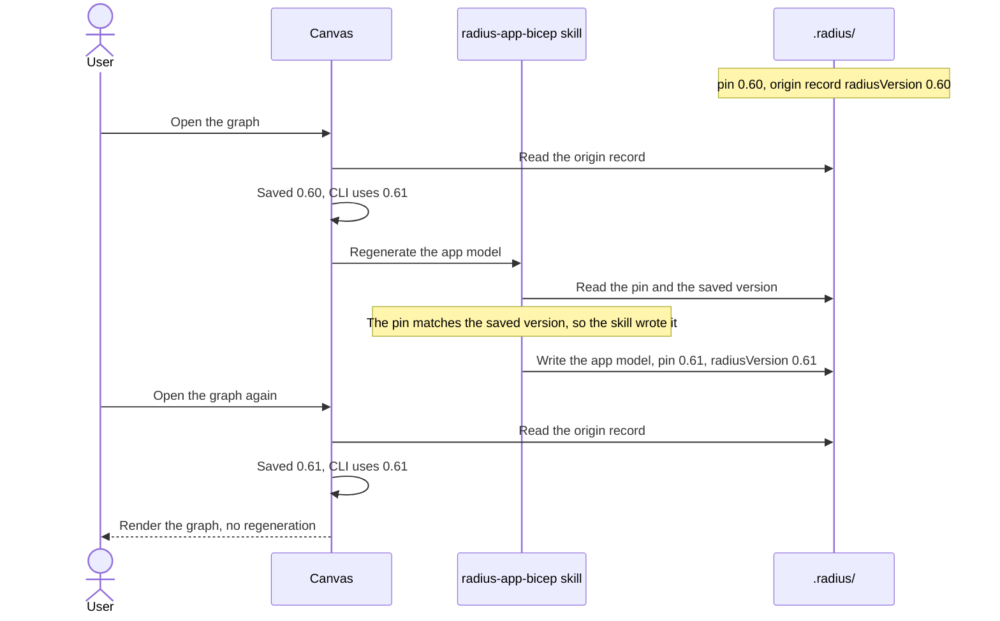

# Recording the Radius version an app model was generated with

- **Author**: Karishma Chawla (@kachawla)
- **Date**: 2026-10

## Current state

Every app model has an origin record, `.radius/app.origin.json`, that the skill writes once the app model passes its Bicep checker. The canvas reads it to decide whether the app model is current. It checks three things: the source commit, the skill version, and a fingerprint of the file. It does not record which Radius version the app model was checked against. That version decides which Radius resource types and properties exist, so an app model that compiles under Radius 0.60 can fail under 0.61.

The Radius plugin installs its own Radius CLI, and upgrading the plugin can move that CLI to a newer Radius version. When that happens, the canvas still reports the app model as current. Asking for a regeneration does not help either. The skill wrote `radius:0.60` into `.radius/bicepconfig.json` as the pin, which is the `extensions.radius` entry that tells Bicep which Radius types to compile against. On the next run, the skill sees that the pin no longer matches the CLI and stops with an error. The user has to find the pin and edit it by hand.

## Proposal

The skill saves the Radius version in the origin record. When the installed Radius CLI uses a newer version, the canvas regenerates the app model. During that regeneration, the skill moves the pin to the new version if the pin is one the skill wrote.

## Objectives

### Goals

1. Regenerate an app model when the installed Radius CLI uses a newer Radius version than the one the app model was generated with.
2. Move the pin to the new version during that regeneration when the skill wrote the pin.
3. Never move a pin that someone set by hand.
4. Never move an app model to an older Radius version, such as when a teammate's plugin is behind.

### Non-goals

1. **Detecting patch releases, such as 0.60.1 to 0.60.2.** Radius publishes one set of types per minor version, so the version cannot tell patches apart, and patches are expected to be compatible.
2. **Detecting changes on edge builds.** Edge always uses `latest`, which says nothing about what changed, and edge needs an explicit developer override to run at all.
3. **Regenerating app models whose origin record was written before this change.** They have no saved version, and regenerating every existing app model at once would be expensive for no proven reason.
4. **Keeping an older Radius version while running a newer CLI.** The skill cannot tell a pin the user chose to keep from one it wrote, so it moves both. This is an advanced setup that can be supported later.

## Design

This is what happens after a plugin upgrade moves the Radius CLI from 0.60 to 0.61. The sections below explain each step.



### Where the Radius version comes from

Each plugin build names one Radius release, in `packages/adapter-shared/src/radius-release.json`. Three things use it:

- The CLI the plugin installs on the user's machine. The plugin replaces it on load when it does not match.
- The deploy workflow. It installs the Radius CLI through the `setup-control-plane` action at the plugin's own commit, which carries the same release.
- The pin, because the skill builds it from the CLI.

So the local CLI and the deploy workflow move together, and moving the pin to the local CLI's version also matches what deploy runs. Before each deploy, the canvas already updates the committed workflow files to the plugin's current templates, which keeps the deploy CLI in step after an upgrade.

### Saving the version

The origin record gets one new field, `radiusVersion`:

```json
{
  "generatedAt": "2026-10-16T05:32:32.000Z",
  "sourceCommit": "<commit the app model was generated from>",
  "skillVersion": "<version of the skill that generated it>",
  "radiusVersion": "0.60",
  "appBicepHash": "sha256:<fingerprint of the app model as generated>"
}
```

`write-app-origin.mjs` reads the value from the pin in the staged `bicepconfig.json`, which is the file the Bicep checker just compiled against. The agent does not pass anything new. The value is the part of the pin after `br:biceptypes.azurecr.io/radius:`.

| Radius CLI release                                                    | `radiusVersion`                 |
|-----------------------------------------------------------------------|---------------------------------|
| `0.60.2`                                                              | `0.60`                          |
| `0.61.0-rc1`                                                          | `0.61.0-rc1`                    |
| `edge`                                                                | `latest`                        |
| The pin is missing or points somewhere other than the Radius registry | empty, and the check is skipped |

Core's `serializeAppOrigin` and `write-app-origin.mjs` both write the new field between `skillVersion` and `appBicepHash`, so the two always produce the same bytes. The next regeneration of each existing app model adds this one line to `app.origin.json`, which is expected.

### Checking the app model

A new check compares the saved version with the one the installed Radius CLI uses:

| Check                                                     | If it fails                             |
|-----------------------------------------------------------|-----------------------------------------|
| Does the installed Radius CLI use a newer Radius version? | `radius-version-changed`, so regenerate |

When the source or the skill also changed, those are reported first, as today. An older CLI is the exception, described below: it is checked before everything else.

The canvas gets the current version from the release the managed Radius CLI reports, mapped with the same rule the skill uses, so the two sides always compare like with like. It reads the release on each graph open, as graph builds already do, because every plugin process on the machine shares the managed CLI and another session's update can replace it at any time. Reads that overlap, such as the two branches of a diff, share one CLI launch. It is not asked at all when the origin record has no saved version to compare with. The read waits for the plugin's own CLI update to finish, and starts that update itself if a graph opens before the plugin has started it, so it never reports the CLI that update is about to replace. An edge release counts only when the user set the developer override, which is the same rule the skill follows.

Versions are compared by number, so 0.61 is newer than 0.60, and 0.61 is newer than 0.61.0-rc1.

| Saved version vs. CLI version | What happens                                                                                                                                                                                                                                                                                                                                                                                       |
|-------------------------------|----------------------------------------------------------------------------------------------------------------------------------------------------------------------------------------------------------------------------------------------------------------------------------------------------------------------------------------------------------------------------------------------------|
| Same                          | Nothing. The app model is current.                                                                                                                                                                                                                                                                                                                                                                 |
| CLI is newer                  | The app model is regenerated, as described below.                                                                                                                                                                                                                                                                                                                                                  |
| CLI is older                  | `radius-cli-outdated`. Nothing is regenerated, even if the source or the skill also changed, because the skill cannot regenerate with an older CLI. The graph renders with a note that the app model was generated with a newer Radius version and the Radius plugin should be updated. Otherwise two teammates on different plugin versions would keep regenerating the app model back and forth. |
| Either side is `latest`       | The check is skipped. `latest` cannot be ordered.                                                                                                                                                                                                                                                                                                                                                  |

The check is also skipped when:

- the origin record has no `radiusVersion`, because it was written before this change or the pin could not be read, or
- the canvas cannot find the CLI or read a supported release from it.

A skipped check never causes a regeneration, since regenerating overwrites the app model and should only happen on clear evidence.

The reason shown to the agent names both versions, for example: "The app model was generated with Radius 0.60, but the installed Radius CLI uses 0.61."

### What happens when the version changed

This follows the existing rules for a skill version change, so the app model is regenerated without asking. Asking would put the same question to the user for every app model after every upgrade, and answering "no" leaves an app model the canvas already knows may not compile.

The canvas asks for each refresh once. The saved version is part of the key it uses to remember a refresh it already asked for, so an upgrade from 0.60 to 0.61 asks once, and a later upgrade to 0.62 asks again. Each app model regenerates once per upgrade, because the new origin record saves the new version.

| Situation                             | What happens                                                                                |
|---------------------------------------|---------------------------------------------------------------------------------------------|
| On the branch the workspace is on     | The skill regenerates the app model, then the graph renders the new one.                    |
| The app model was also edited by hand | The agent explains what would be lost and asks before regenerating.                         |
| On another branch                     | The graph renders with a note. Modeling never commits or pushes, so nothing is regenerated. |

### Moving the pin during regeneration

Today `show-radius-type.mjs` stops when the existing pin differs from the CLI. With this change it also reads `radiusVersion` from `.radius/app.origin.json`, the origin record beside the `.radius/bicepconfig.json` whose pin it may move. A pin that matches the saved version is the one the skill wrote last time, so it is safe to move. Any other pin was set on purpose, and the skill does not overwrite it.

| Existing pin                                                                  | What happens                                                                                            |
|-------------------------------------------------------------------------------|---------------------------------------------------------------------------------------------------------|
| None                                                                          | Use the CLI version. Same as today.                                                                     |
| Same as the CLI                                                               | Keep it. Same as today.                                                                                 |
| Older than the CLI, matches the saved version                                 | Move it to the CLI version.                                                                             |
| Newer than the CLI                                                            | Stop. The error says the app model uses a newer Radius version and the Radius plugin should be updated. |
| Differs from the CLI and from the saved version, or there is no saved version | Stop. The error names the pin and the CLI version and tells the user to update or remove the pin.       |

The move changes only `extensions.radius`. Every other setting and alias in `bicepconfig.json`, such as `customTypes`, is kept as it is. The move is written to the staging folder like every other file in the run, so `.radius/` is not touched until the run publishes, and the existing check that nothing in `.radius/` changed during the run still applies.

This also unblocks a repository whose pin was left at `latest` by an edge run. The saved version is `latest`, the pin matches it, so a later run with a released CLI moves the pin instead of failing.

## Error handling

| Failure                                                      | What the user sees                                                                                                                                                                                                                                               |
|--------------------------------------------------------------|------------------------------------------------------------------------------------------------------------------------------------------------------------------------------------------------------------------------------------------------------------------|
| `write-app-origin.mjs` cannot read the pin                   | The record is still written with an empty `radiusVersion`, and a warning says the check is off for this app model.                                                                                                                                               |
| The canvas cannot find the CLI or read its release           | The check is skipped. If the app model does not compile, the graph shows the compile error as it does today.                                                                                                                                                     |
| `show-radius-type.mjs` cannot read the origin record         | It treats the pin as set by hand and stops with the same error. A pin it cannot prove it wrote is never moved.                                                                                                                                                   |
| Regeneration stops because the pin was set by hand           | The agent reports the error. The canvas asks for the refresh once and does not ask again for the same versions, so there is no loop.                                                                                                                             |
| Regeneration fails for any other reason                      | `.radius/` is left as it was, as it is for every failed modeling run today.                                                                                                                                                                                      |
| The canvas cannot update the deploy workflow before a deploy | Deploy runs with the workflow already on the branch, as it does today, and the canvas tries the update again before the next deploy. If that workflow installs an older Radius CLI than the pin, the deploy can fail, and its error is shown on the deploy page. |

## Test plan

Each behavior is tested at the lowest level that can prove it.

### Core unit tests

- **Origin record:** read and write `radiusVersion` when it is present, missing, blank, or not a string. A record written before this change still parses, with an empty version. The field is written between `skillVersion` and `appBicepHash`.
- **Freshness check:** a newer CLI returns `radius-version-changed`. An older CLI returns `radius-cli-outdated`, which is not stale, with a reason that says to update the plugin, even when the source, skill, or file also changed. `latest` on either side, or an empty version, skips the check. A hand edit plus a newer CLI returns `manually-edited`, so the agent asks first. When more than one thing changed, the source change is reported first, then the skill change, then the Radius version.
- **Version order:** 0.61 is newer than 0.60, 0.61 is newer than 0.61.0-rc1, 0.61.0-rc2 is newer than 0.61.0-rc1, and 0.100 is newer than 0.99.
- **Asking once:** 0.60 to 0.61 and then 0.61 to 0.62 each produce a new refresh key, and the same versions produce the same key.

### Script tests

- **`write-app-origin.mjs`:** every row of the "Saving the version" table, plus a missing or unreadable `bicepconfig.json`, which writes an empty version and a warning. The existing test that the script and core write identical records covers the new field.
- **`show-radius-type.mjs`:** every row of the "Moving the pin" table. A missing or unreadable origin record stops the run rather than moving the pin. A move keeps every other setting and alias, and leaves `.radius/bicepconfig.json` byte for byte unchanged until the run publishes. A `latest` pin left by an edge run moves to the released version, and an edge CLI never replaces a released pin.

### Canvas unit and runtime integration tests

- The graph status passes the version the CLI uses through to the freshness check. Overlapping reads share one CLI launch, and a later read sees a CLI another session replaced.
- A read that starts before the plugin's CLI update returns the updated CLI's version, not the old one on disk.
- A record with no `radiusVersion` does not run the CLI at all.
- A CLI that cannot be found, or that reports a pull request or unauthorized edge release, skips the check rather than failing the graph.
- **Full upgrade flow, with fakes:** a 0.60 origin record with a 0.61 CLI sends one refresh. Once the origin record says 0.61, no more refreshes are sent.
- **Teammate on an older plugin:** a 0.61 origin record with a 0.60 CLI sends no refresh, even when the source also changed, and logs the update-the-plugin note once per panel.
- **Existing app models:** an origin record without `radiusVersion` and a newer CLI sends no refresh.

### Built-extension smoke

- The packaged scripts still load and agree on the origin record format.

### Not needed

- **HTTP integration, Chromium, and visual tests:** no route, page, or UI changes.

### Manual check

- Generate an app model with a 0.60 CLI, switch to 0.61, and open the graph. Capture the refresh request, the new pin, and the new origin record as sample output for the PR.

## Alternatives considered

- **Compare against the pin instead of the CLI.** Rejected: the pin never changes on its own, so a CLI upgrade would never be noticed.
- **Regenerate whenever the versions differ, including to an older one.** Rejected: two teammates on different plugin versions would keep regenerating the app model back and forth.
- **Save the full reference, `br:biceptypes.azurecr.io/radius:0.60`.** Rejected: the registry part never changes, and a field named for an extension is easy to confuse with the Radius Canvas extension.
- **Hash `bicepconfig.json`.** Rejected: the file holds unrelated settings, such as custom type aliases, so an unrelated edit would flag a good app model.
- **Save the Radius CLI commit.** Deferred: it is the only value that identifies the exact types, but it would regenerate on every patch release. It can be added later as a separate field.
- **Have the agent pass the version as a flag to `write-app-origin.mjs`.** Rejected: the agent could pass the wrong value, while the staged pin is exactly what the checker compiled against.
